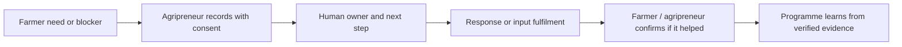
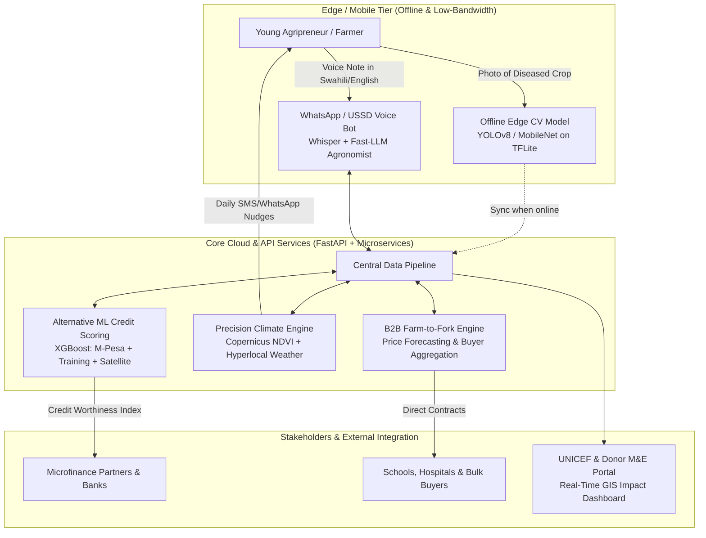

# EKYAN Connect
### A practical coordination and intelligence platform for the EKYAN programme
*Help agripreneurs turn farmer needs into accountable responses, input fulfilment and verified learning.*

[](https://opensource.org/licenses/Apache-2.0)
[](https://www.unicef.org/kenya/)
[](https://sdgs.un.org/goals)

---

## 📌 Executive Summary

The **EKYAN** (**Engaging Kenyan Youth in Agriculture and Nutrition**) program is a flagship multi-stakeholder partnership spearheaded by **UNICEF Kenya**, the **Government of Kenya**, and **Generation Unlimited (GenU)** alongside partners such as SNV, Kuza Biashara, and Educate!. 

The immediate product problem is operational: a farmer's need or blocker can be recorded during programme activity, but ownership, response, fulfilment and confirmation are hard to follow across people and organisations. EKYAN Connect gives agripreneurs one simple workflow to close that loop, while giving the programme a clearer view of what is still waiting and what has been confirmed.

> **Current pilot direction:** start with the Busia poultry cohort and synthetic data. The MVP prioritizes offline field capture, blocker ownership and follow-up, pooled input requests, supplier response and farmer/agripreneur confirmation. Bookkeeping and a finance-preparation checklist support the workflow. Scores, credit decisions, live advisory, climate services and buyer/investor matching are not MVP promises. See [EKYANBRS.md](./EKYANBRS.md) for scope and safeguards.

The older module specifications below describe design concepts and possible later phases; they are not evidence of production integrations or validated outcomes.

---

## 🏛️ Pilot operating loop



The interface should make the next action obvious: **Today**, **Record a need**, **Follow up**, and **Business records**. It should work with intermittent connectivity and clearly label synthetic or unverified information.

## 🏛️ Longer-term architecture concepts



---

## 🚀 The 5 Core Engineering Modules

### [1. Offline-First AI Pocket Agronomist (`/docs/01_AI_Pocket_Agronomist.md`)](./docs/01_AI_Pocket_Agronomist.md)
* **Edge Computer Vision:** Quantized MobileNetV3 / YOLOv8-nano model packaged into an Android `.tflite` model running inference in under 80ms on entry-level Android devices without internet.
* **Multilingual Agronomist Chatbot:** Localized in Swahili and English, integrated into low-cost channels (WhatsApp Business API and SMS/USSD) to deliver culturally relevant, regenerative farming advice.

### [2. Alternative ML Credit Scoring Engine (`/docs/02_Alternative_Credit_Scoring.md`)](./docs/02_Alternative_Credit_Scoring.md)
* **Non-Traditional Underwriting:** Uses gradient-boosted trees (XGBoost/LightGBM) to calculate creditworthiness for unbanked youth.
* **Data Features:** Evaluates M-Pesa transaction velocity, EKYAN learning module completion rates, cooperative peer verification, and historical satellite-derived vegetation indices (NDVI) of the youth's farm plot.

### [3. Hyperlocal Climate & Regenerative Advisory (`/docs/03_Hyperlocal_Climate_Advisory.md`)](./docs/03_Hyperlocal_Climate_Advisory.md)
* **Satellite Remote Sensing:** Ingests Sentinel-2 multispectral satellite data to track canopy moisture and soil vegetation health.
* **Predictive Nudge Engine:** Sends automated daily actionable prompts (e.g., *"Skip irrigation today—90% rain probability at 15:00 in Kirinyaga"* or *"High humidity spike: inspect tomatoes for early blight"*).

### [4. B2B Farm-to-Fork Marketplace & Price Forecaster (`/docs/04_B2B_Farm_To_Fork_Marketplace.md`)](./docs/04_B2B_Farm_To_Fork_Marketplace.md)
* **Price Forecasting:** Time-series ML model predicting price trends across major wholesale markets (Nairobi, Kisumu, Mombasa).
* **Direct Buyer Matching:** Aggregates harvests from small youth clusters to meet bulk volume requirements for school feeding schemes, hospitals, and urban distributors, eliminating predatory brokers.

### [5. UNICEF & Donor Impact M&E Dashboard (`/docs/05_UNICEF_Donor_ME_Dashboard.md`)](./docs/05_UNICEF_Donor_ME_Dashboard.md)
* **Real-Time Monitoring & Evaluation:** Full-stack dashboard (React/TypeScript + FastAPI + PostGIS) displaying youth employment rates, acreage cultivated under regenerative practices, carbon sequestration metrics, and household nutrition statistics across target counties.

---

## 🛠️ Technology Stack

| Layer | Technologies |
| :--- | :--- |
| **Edge AI & Computer Vision** | PyTorch, ONNX Runtime, TensorFlow Lite, OpenCV, YOLOv8-nano |
| **Conversational AI & NLP** | Whisper (Speech-to-Text), Meta-Llama / Gemini Flash, LangChain, Twilio / WhatsApp Cloud API |
| **Backend & Microservices** | Python 3.11+, FastAPI, Celery, Redis, Pydantic |
| **Database & GIS** | PostgreSQL 16, PostGIS, Supabase, TimescaleDB |
| **Machine Learning & Analytics** | Scikit-Learn, XGBoost, Pandas, GeoPandas, Prophet |
| **Satellite & Earth Observation** | Sentinel Hub, Copernicus Open Access Hub, Google Earth Engine API |
| **Frontend & Visualization** | Next.js 14, TailwindCSS, Mapbox GL / Leaflet, Recharts |

---

## 🌍 UN Sustainable Development Goals (SDGs) Alignment

* **SDG 1 (No Poverty):** Unlocks fair income streams and credit for marginalized rural youth.
* **SDG 2 (Zero Hunger):** Boosts crop yields, reduces pest losses, and improves child nutrition.
* **SDG 5 (Gender Equality):** Tailors alternative credit and mobile tools to young mothers and female agripreneurs.
* **SDG 8 (Decent Work & Economic Growth):** Creates viable, dignified green employment in agriculture.
* **SDG 13 (Climate Action):** Institutionalizes climate-smart and regenerative farming practices.

---

## 📲 Messaging integration concepts

WhatsApp Flows may provide a later channel for structured interactions, subject to programme approval, consent, connectivity and partner setup. The flows below are concepts, not live integrations.

### Proposed flows

| Flow | Purpose | Feeds Into |
| :--- | :--- | :--- |
| **Finance Record Preparation** | Helps users review records and evidence coverage, with explicit consent before any future partner sharing | Human-reviewed, consent-gated finance profile (no score or approval prediction) |
| **Blocker Report** | Structured form for inputs / finance / market / climate blockers | SQS → M&E dashboard |
| **Harvest Registration** | Registers commodity, volume, harvest date | Buyer matching engine |

### Quick Start (Terminal)

```bash
# 1. Check dependencies
./scripts/flows_manager.sh setup

# 2. Start the backend
cd src && uvicorn main:app --reload --port 8000

# 3. Validate all 3 flow JSONs locally (no Meta account needed)
./scripts/flows_manager.sh validate

# 4. Preview in browser — copies JSON to clipboard + opens Meta Playground
./scripts/flows_manager.sh preview credit_prequalification
./scripts/flows_manager.sh preview blocker_report
./scripts/flows_manager.sh preview harvest_registration
```

### Deploy to Meta (once you have credentials)

```bash
# Create .env.flows from the example
cp .env.flows.example .env.flows
# Fill in: WA_TOKEN, WABA_ID, WA_PHONE_ID

# Deploy all 3 flows in one command
./scripts/flows_manager.sh all

# Or step by step:
./scripts/flows_manager.sh create  credit_prequalification
./scripts/flows_manager.sh upload  <flow_id> credit_prequalification
./scripts/flows_manager.sh publish <flow_id>

# Send a flow to a farmer
./scripts/flows_manager.sh send 254712345678 credit_prequalification <flow_id>

# List all deployed flows
./scripts/flows_manager.sh list
```

### Getting Meta Credentials

1. Go to [developers.facebook.com/apps](https://developers.facebook.com/apps) → **Create App** → Business → Add WhatsApp product
2. From **WhatsApp → API Setup**, copy:
   - `WA_TOKEN` — temporary 24h token (or create a permanent System User token)
   - `WABA_ID` — WhatsApp Business Account ID
   - `WA_PHONE_ID` — Phone Number ID
3. Add `WHATSAPP_APP_SECRET` from **App Settings → Basic → App Secret** to your `.env`

> **Note:** `.env.flows` is gitignored. Never commit tokens.

---

## 🖥️ Local Development

### EKYAN MVP backend (FastAPI)

```powershell
# From the repository root; the lean manifest avoids installing the ML stack.
python -m venv .venv
# Windows PowerShell:
.\.venv\Scripts\Activate.ps1
pip install -r requirements-api.txt
New-Item -ItemType Directory -Force data
$env:EKYAN_ENV = "development"
$env:EKYAN_ENABLE_DEMO_AUTH = "true"
$env:EKYAN_DATABASE_URL = "sqlite:///../data/ekyan_local.db"
Set-Location src
uvicorn main:app --reload --port 8000
# API docs: http://localhost:8000/docs
```

The MVP starts with synthetic Busia/Poultry records in a local SQLite database. Create a local prototype account from the sign-in screen using a `Synthetic` or `Demo` name, an `.invalid` email address, and a password with at least 12 characters. Agripreneur access is immediate; partner and programme roles wait for administrator approval. The API verifies every account token and role, records sign-in and approval events, and revokes sessions on sign-out. Legacy demo-role sign-in is for local development only.

To review pending partner-role requests locally, optionally set `EKYAN_BOOTSTRAP_ADMIN_EMAIL=demo.admin@example.invalid` and a test-only `EKYAN_BOOTSTRAP_ADMIN_PASSWORD` of at least 12 characters before the first API startup. The bootstrap administrator is created once in the database; never reuse a personal password.

To add the reproducible larger demo dataset to a local SQLite database, run this from the repository root. It is an additive seed, requires `--apply`, refuses non-SQLite databases and existing non-synthetic participant/activity data, and can be run only once per database:

```powershell
$env:EKYAN_DATABASE_URL = "sqlite:///data/ekyan_local.db"
.\.venv\Scripts\python.exe scripts\seed_synthetic_demo.py --apply
```

The seed fills the pilot to 15 agripreneurs, 3 suppliers, 1,500 farmers, 2,000 orders, 300 blockers, 600 adoption intentions, six months of transactions/savings, and six synthetic programme-cost periods. It uses generated demo labels, no phone numbers, and no real partner or market feed.

The field log also accepts consent-gated synthetic adoption intentions through the offline queue. K6 reports the share of farmers with a logged intention who have a fulfilled order; this is a service-action proxy, not verification that a farming practice was adopted.

### Frontend (Next.js)

```bash
cd frontend
npm install
npm run dev
# UI: http://localhost:3000
```

The frontend defaults to `http://localhost:8000` for the API, matching the local backend and its HttpOnly session cookie. Set `NEXT_PUBLIC_API_URL` before starting Next.js if the backend is hosted elsewhere.

### Scope and production readiness

The local MVP accepts synthetic records only. Do not enter real participant information or connect WhatsApp, M-Pesa, lenders, suppliers, or other partners. Authentication now has account creation, password sign-in, scrypt password hashes, signed and revocable sessions, HttpOnly browser cookies, per-user roles, admin review for partner roles, and role-checked APIs. Account registration is enabled in development with synthetic names and `.invalid` email addresses; production registration is off unless `EKYAN_ENABLE_REGISTRATION=true`. Production still requires privacy and partner approvals, HTTPS, managed secrets, a PostgreSQL database, backup/restore validation, rate limiting, email verification and recovery, monitoring, and end-to-end deployment review. The legacy agronomist, credit-scoring, climate, and marketplace modules remain separate services and are not enabled as live partner integrations by this MVP.

### Environment Variables

Copy `.env.flows.example` to `.env.flows` for WhatsApp Flows credentials.
All other secrets (AWS, Gemini, WhatsApp) go in `.env` (gitignored).

Key variables:

| Variable | Description |
| :--- | :--- |
| `DATABASE_URL` | Aurora PostgreSQL connection string |
| `GEMINI_API_KEY` | Google Gemini Flash API key (powers the agronomist bot) |
| `WHATSAPP_ACCESS_TOKEN` | Meta WhatsApp Cloud API token |
| `WHATSAPP_PHONE_NUMBER_ID` | Meta phone number ID |
| `WHATSAPP_APP_SECRET` | Meta app secret for webhook signature verification |
| `WHATSAPP_VERIFY_TOKEN` | Custom token for webhook verification (default: `ekyan_verify`) |
| `NEXT_PUBLIC_API_URL` | Backend URL for the frontend (default: `http://localhost:8000`) |
| `EKYAN_DATABASE_URL` | Local MVP database; use SQLite during synthetic development |
| `EKYAN_AUTH_SECRET` | Required 32+ character signing secret when `EKYAN_ENV=production` |
| `EKYAN_ENABLE_DEMO_AUTH` | Enables synthetic role sign-in in development; must be false in production |
| `EKYAN_ENABLE_REGISTRATION` | Enables account sign-up; defaults off in production until privacy approvals are complete |
| `NEXT_PUBLIC_EKYAN_SYNTHETIC_MODE` | Shows synthetic-only guidance in web sign-up; keep true until approved for live account data |
| `EKYAN_BOOTSTRAP_ADMIN_EMAIL` | Initial production administrator email; provisioned once at startup when absent |
| `EKYAN_BOOTSTRAP_ADMIN_PASSWORD` | Initial production administrator password (12+ chars); provide through the deployment secret manager |
| `EKYAN_BOOTSTRAP_ADMIN_NAME` | Initial administrator display name |

The database already exists: SQLAlchemy uses SQLite by default for local synthetic development. Set `EKYAN_DATABASE_URL=postgresql+psycopg://...` for a persistent PostgreSQL deployment. Startup applies additive account-column migration and creates a unique email index; back up production data before upgrades. Configure bootstrap administrator credentials on the first production start, then remove the bootstrap password from deployment configuration.

---

## ☁️ AWS Infrastructure

Deployed via AWS CDK to `af-south-1` (Cape Town):

| Service | Purpose |
| :--- | :--- |
| **Aurora Serverless v2** (PostgreSQL 16) | Primary relational database |
| **DynamoDB** | Sessions & credit score cache |
| **SQS** | Async blocker events & harvest registrations |
| **S3** | Satellite imagery & model artefacts |

```bash
# Deploy infrastructure
cd infra && cdk deploy EkyanStack

# Stop Aurora to pause billing
./infra/pause_stack.sh

# Resume Aurora
./infra/resume_stack.sh
```

---

## 📂 Repository Structure

```
├── docs/
│   ├── 01_AI_Pocket_Agronomist.md
│   ├── 02_Alternative_Credit_Scoring.md
│   ├── 03_Hyperlocal_Climate_Advisory.md
│   ├── 04_B2B_Farm_To_Fork_Marketplace.md
│   ├── 05_UNICEF_Donor_ME_Dashboard.md
│   └── 06_Partnership_and_Funding_Strategy.md
├── frontend/                               # Next.js 14 + TailwindCSS dashboard
│   ├── app/
│   │   ├── agronomist/page.tsx             # WhatsApp-style chat UI
│   │   ├── dashboard/page.tsx              # M&E KPI dashboard
│   │   ├── credit/page.tsx
│   │   ├── climate/page.tsx
│   │   └── marketplace/page.tsx
│   └── components/
├── infra/
│   ├── cdk_stack.py                        # AWS CDK stack (Aurora, DynamoDB, SQS, S3)
│   ├── pause_stack.sh                      # Stop Aurora to save costs
│   └── resume_stack.sh
├── scripts/
│   └── flows_manager.sh                   # WhatsApp Flows CLI manager
├── src/
│   ├── swahili_voice_bot/
│   │   ├── app.py                          # WhatsApp webhook + Gemini agronomist
│   │   ├── flows.py                        # WhatsApp Flows JSON + handlers
│   │   └── blocker_store.py               # Blocker detection → SQS
│   ├── credit_scoring/model.py
│   ├── climate_engine/advisory.py
│   ├── marketplace/engine.py
│   ├── aws_clients.py
│   └── main.py                             # FastAPI app entrypoint
├── .env.flows.example                      # WhatsApp Flows credentials template
├── requirements.txt
├── LICENSE
└── README.md
```

---

## 🤝 How to Pitch & Collaborate with UNICEF & Partners

For detailed step-by-step guidance on applying for the **UNICEF Innovation Fund ($100k equity-free grant)** and pitching to **Kuza Biashara** and **SNV Kenya**, see [**`docs/06_Partnership_and_Funding_Strategy.md`**](./docs/06_Partnership_and_Funding_Strategy.md).

---

*Authored by Bhekumusa Eric Ntshwenya | Dedicated to Youth Empowerment & Climate-Smart Food Systems in East Africa.*

