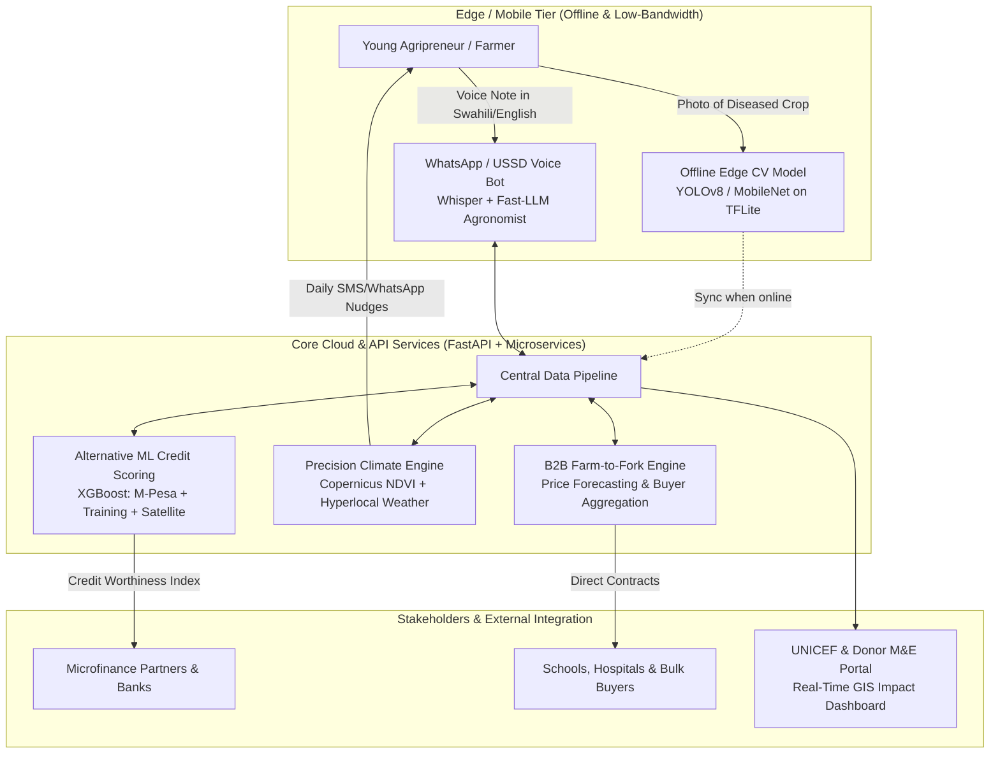

# EKYAN AI & Agritech Engineering Framework
### Open-Source Digital Blueprint for UNICEF Kenya & Generation Unlimited (GenU)
*Empowering Young Agripreneurs with Offline Edge AI, Alternative Credit Scoring, Precision Climate Intelligence, and Fair Market Access.*

[](https://opensource.org/licenses/Apache-2.0)
[](https://www.unicef.org/kenya/)
[](https://sdgs.un.org/goals)

---

## 📌 Executive Summary

The **EKYAN** (**Engaging Kenyan Youth in Agriculture and Nutrition**) program is a flagship multi-stakeholder partnership spearheaded by **UNICEF Kenya**, the **Government of Kenya**, and **Generation Unlimited (GenU)** alongside partners such as SNV, Kuza Biashara, and Educate!. 

While EKYAN provides training and community hubs, young agripreneurs face critical systemic hurdles:
1. **Pest & Crop Failure:** Lack of localized extension services leading to devastating crop losses.
2. **Financial Exclusion:** Inability to access credit without land titles or traditional collateral.
3. **Severe Climate Shocks:** Recurring droughts and unseasonal rains in arid and semi-arid lands (ASALs).
4. **Predatory Middlemen:** Farmgate price exploitation and absence of cold-chain storage.
5. **Connectivity Constraints:** Remote rural youth operating on low-end smartphones with intermittent 2G/3G connectivity.

**This repository provides a comprehensive, production-ready AI and Software Engineering framework designed to directly solve these challenges.**

---

## 🏛️ System Architecture



---

## 🚀 The 5 Core Engineering Modules

### [1. Offline-First AI Pocket Agronomist (`/docs/01_AI_Pocket_Agronomist.md`)](./docs/01_AI_Pocket_Agronomist.md)
* **Edge Computer Vision:** Quantized MobileNetV3 / YOLOv8-nano model packaged into an Android `.tflite` model running inference in under 80ms on entry-level Android devices without internet.
* **Multilingual Agronomist Chatbot:** Localized in Swahili and English, integrated into low-cost channels (WhatsApp Business API and SMS/USSD) to deliver culturally relevant, regenerative farming advice.

### [2. Alternative ML Credit Scoring Engine (`/docs/02_Alternative_Credit_Scoring.md`)](./docs/02_Alternative_Credit_Scoring.md)
* **Non-Traditional Underwriting:** Uses gradient-boosted trees (XGBoost/LightGBM) to calculate creditworthiness for unbanked youth.
* **Data Features:** Evaluates M-Pesa transaction velocity, EKYAN learning module completion rates, cooperative peer verification, and historical satellite-derived vegetation indices (NDVI) of the youth's farm plot.

### [3. Hyperlocal Climate & Regenerative Advisory (`/docs/03_Hyperlocal_Climate_Advisory.md`)](./docs/03_Hyperlocal_Climate_Advisory.md)
* **Satellite Remote Sensing:** Ingests Sentinel-2 multispectral satellite data to track canopy moisture and soil vegetation health.
* **Predictive Nudge Engine:** Sends automated daily actionable prompts (e.g., *"Skip irrigation today—90% rain probability at 15:00 in Kirinyaga"* or *"High humidity spike: inspect tomatoes for early blight"*).

### [4. B2B Farm-to-Fork Marketplace & Price Forecaster (`/docs/04_B2B_Farm_To_Fork_Marketplace.md`)](./docs/04_B2B_Farm_To_Fork_Marketplace.md)
* **Price Forecasting:** Time-series ML model predicting price trends across major wholesale markets (Nairobi, Kisumu, Mombasa).
* **Direct Buyer Matching:** Aggregates harvests from small youth clusters to meet bulk volume requirements for school feeding schemes, hospitals, and urban distributors, eliminating predatory brokers.

### [5. UNICEF & Donor Impact M&E Dashboard (`/docs/05_UNICEF_Donor_ME_Dashboard.md`)](./docs/05_UNICEF_Donor_ME_Dashboard.md)
* **Real-Time Monitoring & Evaluation:** Full-stack dashboard (React/TypeScript + FastAPI + PostGIS) displaying youth employment rates, acreage cultivated under regenerative practices, carbon sequestration metrics, and household nutrition statistics across target counties.

---

## 🛠️ Technology Stack

| Layer | Technologies |
| :--- | :--- |
| **Edge AI & Computer Vision** | PyTorch, ONNX Runtime, TensorFlow Lite, OpenCV, YOLOv8-nano |
| **Conversational AI & NLP** | Whisper (Speech-to-Text), Meta-Llama / Gemini Flash, LangChain, Twilio / WhatsApp Cloud API |
| **Backend & Microservices** | Python 3.11+, FastAPI, Celery, Redis, Pydantic |
| **Database & GIS** | PostgreSQL 16, PostGIS, Supabase, TimescaleDB |
| **Machine Learning & Analytics** | Scikit-Learn, XGBoost, Pandas, GeoPandas, Prophet |
| **Satellite & Earth Observation** | Sentinel Hub, Copernicus Open Access Hub, Google Earth Engine API |
| **Frontend & Visualization** | Next.js 14, TailwindCSS, Mapbox GL / Leaflet, Recharts |

---

## 🌍 UN Sustainable Development Goals (SDGs) Alignment

* **SDG 1 (No Poverty):** Unlocks fair income streams and credit for marginalized rural youth.
* **SDG 2 (Zero Hunger):** Boosts crop yields, reduces pest losses, and improves child nutrition.
* **SDG 5 (Gender Equality):** Tailors alternative credit and mobile tools to young mothers and female agripreneurs.
* **SDG 8 (Decent Work & Economic Growth):** Creates viable, dignified green employment in agriculture.
* **SDG 13 (Climate Action):** Institutionalizes climate-smart and regenerative farming practices.

---

## 📂 Repository Structure

```
├── docs/
│   ├── 01_AI_Pocket_Agronomist.md          # Edge CV & WhatsApp Swahili Bot Spec
│   ├── 02_Alternative_Credit_Scoring.md    # ML Underwriting Model & Feature Engineering
│   ├── 03_Hyperlocal_Climate_Advisory.md   # Satellite Data & Precision Climate Pipeline
│   ├── 04_B2B_Farm_To_Fork_Marketplace.md  # Price Forecaster & Contract Aggregator
│   ├── 05_UNICEF_Donor_ME_Dashboard.md     # Full-Stack M&E Analytics Architecture
│   └── 06_Partnership_and_Funding_Strategy.md # UNICEF Innovation Fund Pitch Playbook
├── src/
│   ├── crop_disease_model/
│   │   └── predict.py                      # Edge inference prototype for leaf pathology
│   ├── swahili_voice_bot/
│   │   └── app.py                          # FastAPI conversational agronomist endpoint
│   ├── credit_scoring/
│   │   └── model.py                        # Alternative ML credit score pipeline
│   └── climate_engine/
│       └── advisory.py                     # NDVI & micro-weather rule engine
├── requirements.txt                        # Python dependencies
├── LICENSE                                 # Apache 2.0 Open Source License
└── README.md                               # Project Overview
```

---

## 🤝 How to Pitch & Collaborate with UNICEF & Partners

For detailed step-by-step guidance on applying for the **UNICEF Innovation Fund ($100k equity-free grant)** and pitching to **Kuza Biashara** and **SNV Kenya**, see [**`docs/06_Partnership_and_Funding_Strategy.md`**](./docs/06_Partnership_and_Funding_Strategy.md).

---

*Authored by Bhekumusa Eric Ntshwenya | Dedicated to Youth Empowerment & Climate-Smart Food Systems in East Africa.*
