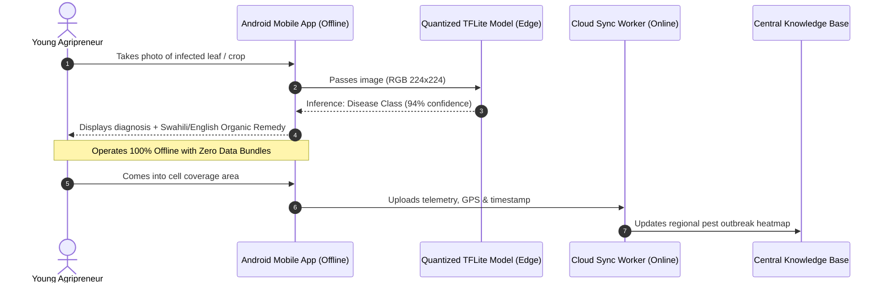

# Module 1: AI Pocket Agronomist (Offline Edge CV & Multilingual Chatbot)

## 1. Problem Statement
In rural Kenyan counties (e.g., Busia, Samburu, Kirinyaga), the ratio of agricultural extension officers to smallholder farmers is critically low (often exceeding 1:1,500). When pests (like the Fall Armyworm or Tomato Leaf Miner *Tuta absoluta*) strike, young agripreneurs must travel long distances or rely on unverified rumors, frequently leading to catastrophic crop loss. Furthermore, poor network connectivity prevents cloud-only AI assistants from working reliably in the field.

---

## 2. Technical Solution Architecture



---

## 3. Computer Vision Model Pipeline

### Model Selection & Quantization
* **Base Architecture:** MobileNetV3-Small or YOLOv8-nano.
* **Dataset:** PlantVillage extended with East African field datasets (cassava brown streak disease, maize lethal necrosis, tomato leaf miner).
* **Optimization:** 8-bit Post-Training Quantization (INT8) using TensorFlow Lite / ONNX Runtime.
* **Footprint:** Model binary $< 12 \text{ MB}$, memory consumption $< 85 \text{ MB}$, inference latency $\le 75 \text{ ms}$ on MediaTek Helio / Snapdragon 400 series chipsets.

### Diagnosis Categories
1. **Maize:** Fall Armyworm, Maize Streak Virus, Northern Corn Leaf Blight.
2. **Tomatoes:** Early Blight, Late Blight, Bacterial Spot, *Tuta absoluta*.
3. **Cassava:** Cassava Mosaic Disease (CMD), Cassava Brown Streak Disease (CBSD).
4. **Legumes:** Anthracnose, Rust, Aphid infestation.

---

## 4. Multilingual Conversational Interface (WhatsApp & USSD)

For non-smartphone users or audio-preference learners, the module exposes a conversational service accessible via WhatsApp Business API:

* **Audio Input:** Whisper small quantized model for Speech-to-Text supporting Kenyan Swahili accents and code-switching (*Sheng*).
* **Reasoning Engine:** Fine-tuned small language model (LLM) constrained by a verified agronomist knowledge retrieval corpus (RAG).
* **Prompt Guardrails:** Strict adherence to regenerative and climate-smart agricultural techniques (prescribing compost tea, neem oil, companion planting rather than toxic, expensive synthetic pesticides).

---

## 5. Sample Voice Bot Prompt & Guardrails

```markdown
System Prompt:
You are "Daktari wa Mimea", an expert agronomist assistant for youth farmers in Kenya under the UNICEF EKYAN project.
- Respond in clear, respectful, and friendly Swahili (with English fallback if the user asks in English).
- Prioritize low-cost, organic, and regenerative solutions accessible to rural smallholders (e.g., wood ash, neem extract, crop rotation).
- Include preventative advice to protect community nutrition and soil fertility.
- Keep answers under 3 concise bullet points.
```
