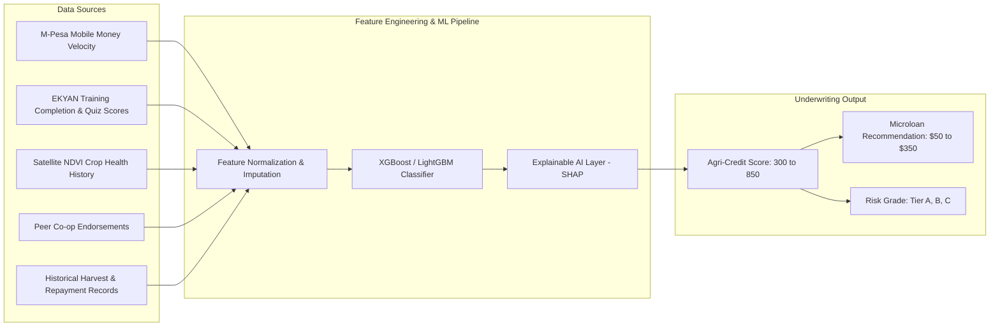

# Module 2: Alternative ML Credit Scoring for Youth Agripreneurs

## 1. Problem Statement
Commercial banks and formal lenders in Kenya require three primary underwriting components:
1. Formal land ownership (Title Deeds).
2. Documented payroll pay stubs.
3. Conventional credit bureau history (CRB).

Young people—particularly rural youth, young mothers, and out-of-school agripreneurs—possess none of these. As a result, 85%+ of youth farming initiatives in Kenya cannot access working capital loans to purchase drip kits, high-yield seeds, or bio-fertilizers.

---

## 2. Alternative Data Feature Matrix

Our Machine Learning framework calculates an **Agri-Creditworthiness Index (ACI)** using non-traditional behavioral, educational, and earth-observation data points:

### Feature Weights and Data Vectors

| Feature Category | Specific Indicators | Weight | Source |
| :--- | :--- | :---: | :--- |
| **Commitment & Knowledge** | EKYAN modules completed, quiz mastery, attendance at demo days | 25% | LMS / Kuza Learning Platform |
| **Financial Discipline** | M-Pesa cash inflows, bill payments, consistency of savings in *Chama* (village savings group) | 25% | Mobile Money Telemetry (with consent) |
| **Physical Cultivation Proof** | Satellite-verified NDVI greenness curve over 2 consecutive seasons | 20% | Sentinel-2 / European Space Agency |
| **Social Capital & Trust** | Peer endorsements, local chief or mentor verification, cooperative standing | 15% | Cooperative Hub Data |
| **Market Discipline** | Record of previous produce dispatches and adherence to delivery contracts | 15% | B2B Marketplace History |

---

## 3. Algorithm & Explainability

* **Base Model:** Gradient-boosted decision trees (`XGBClassifier`) optimized for imbalanced tabular credit datasets.
* **Fairness & Bias Audit:** Strict exclusion of protected demographic features (ethnicity, clan, marital status). Continuous calibration to ensure equal opportunity and parity for young mothers and female entrepreneurs.
* **Explainability (SHAP):** Every credit decision outputs an explainability breakdown. If a young applicant is denied, the system generates actionable advice:
  * *"Complete 2 more regenerative agriculture modules on pest control."*
  * *"Maintain consistent weekly savings in your cooperative account for 30 more days."*

---

## 4. Integration with Microfinance Institutions & UNICEF Seed Grants

The generated score is exposed via a secure REST API to local partner microfinance institutions (e.g., Faulu Kenya, Kenya Women Microfinance Bank - KWFT, Equity Group Foundation) or used to prioritize UNICEF revolving seed grant disbursements.
