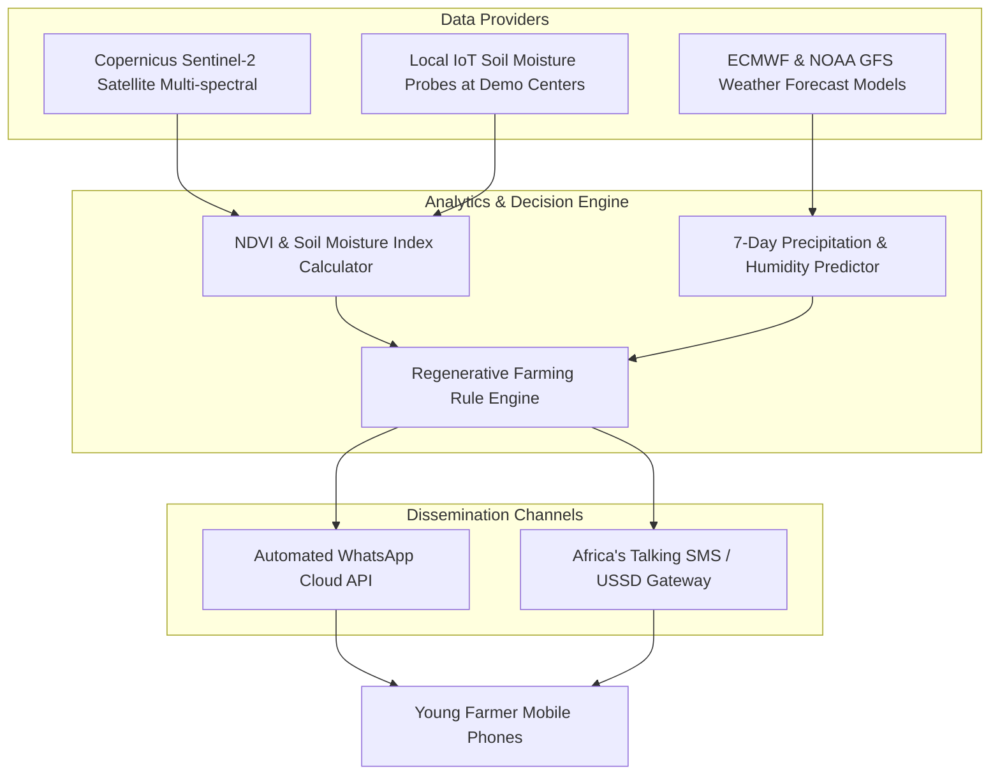

# Module 3: Hyperlocal Climate & Regenerative Advisory Pipeline

## 1. Problem Statement
Smallholder farming in Kenya faces escalating volatility due to severe climate change shocks. Farmers frequently plant too early or too late, waste scarce irrigation water right before unpredicted rainfall, or lose crops to unexpected fungal blooms triggered by sudden humidity spikes. 

---

## 2. Technical Ingestion Architecture

---

## 3. Earth Observation (NDVI) Formulation

Using Sentinel-2 Level-2A imagery across Red (Band 4) and Near-Infrared (Band 8):

$$\text{NDVI} = \frac{\text{NIR} - \text{Red}}{\text{NIR} + \text{Red}} = \frac{\text{B08} - \text{B04}}{\text{B08} + \text{B04}}$$

* **$\text{NDVI} < 0.20$:** Bare soil, water stress, or germination failure.
* **$0.20 \le \text{NDVI} \le 0.50$:** Moderate vegetation, early vegetative stage.
* **$\text{NDVI} > 0.50$:** Dense, healthy, active canopy.

---

## 4. Rule-Based Precision Action Engine

| Weather & Soil Trigger | Automated Advisory Message (Swahili & English) |
| :--- | :--- |
| **High Precipitation Imminent ($\ge 15\text{ mm}$ within 24h)** | *"Mvua kubwa inatarajiwa kesho saa nane mchana. Usinyunyizie maji leo wala kuweka mbolea ya majani kuzuia isisafishwe na mvua."* *(Heavy rain expected tomorrow at 2 PM. Avoid irrigating today or applying foliar fertilizer to prevent nutrient runoff.)* |
| **High Heat + Low Soil Moisture ($T > 32^\circ\text{C}$, $\text{Moisture} < 18\%$)** | *"Kuna joto kali wiki hii. Funika mashina ya mimea na nyasi kavu (mulching) ili kuzuia unyevu kupotea kwenye udongo."* *(Extreme heat forecasted this week. Apply dry organic mulching around crop roots to preserve soil moisture.)* |
| **High Humidity ($> 85\%$) + Moderate Temp ($18\text{--}24^\circ\text{C}$)** | *"Hali ya hewa inachochea ugonjwa wa ukungu (blight) kwenye nyanya. Kagua sehemu za chini za majani na uweke dawa ya asili ya majivu au mwarobaini mapema."* *(Weather conditions favor blight on tomatoes. Inspect lower leaves and apply preventative neem/wood-ash organic extract early.)* |

