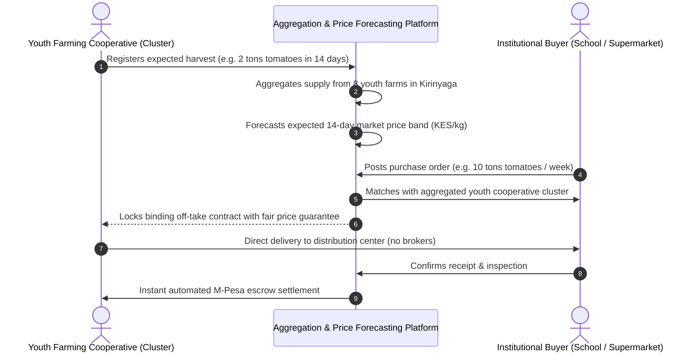

# Module 4: B2B Farm-to-Fork Marketplace & Price Forecaster

## 1. Problem Statement
In traditional agricultural supply chains across Kenya, young smallholder farmers sell their produce at farmgate to informal brokers (*middlemen*). Brokers routinely underpay by 40% to 65% of the real wholesale terminal price in Nairobi, Kisumu, or Mombasa. Furthermore, individual youth farmers lack the volume to sell directly to institutional buyers (such as secondary school feeding schemes, hospitals, and supermarket distributors).

---

## 2. System Workflow: Aggregation & Fair Matching

---

## 3. Commodity Price Forecasting Model

* **Architecture:** Additive regression time-series forecasting (Facebook Prophet / NeuralProphet) or LightGBM regressor with autoregressive lag features.
* **Input Features:**
  * Historical daily wholesale market prices from Kenya National Bureau of Statistics (KNBS) and Ministry of Agriculture.
  * Seasonal rainfall indicators and drought indices.
  * Diesel and transport fuel price indices.
  * Public holiday and school term dates (demand surges).
* **Output:** Predicted price distribution (KES/kg) with $80\%$ confidence intervals over a 30-day forecast horizon.

---

## 4. Contract Pooling & Logistics Optimization

To resolve the lack of cold-chain infrastructure:
1. **Dynamic Pickup Scheduling:** Groups neighboring youth farms into a shared logistics run so a single refrigerated truck can collect from 5–10 farms in a tight geographical radius.
2. **School Feeding Program Integration:** Directly pairs youth farms with local secondary schools under the Ministry of Education feeding program, ensuring zero food miles and zero intermediary markups.
