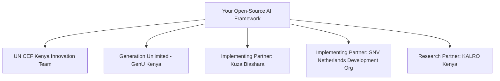

# Module 6: Partnership, Pitching & Funding Strategy

## 1. UNICEF Innovation Fund Application Playbook

The **UNICEF Innovation Fund** provides up to **$100,000 USD equity-free seed funding** for early-stage open-source technology projects that benefit children and youth in developing markets.

### Key Criteria Required by UNICEF:
1. **Open-Source Core:** Must be licensed under an approved open-source license (e.g., Apache 2.0 or BSD-3). *This repository strictly complies.*
2. **Working Prototype:** A functioning proof-of-concept (POC) demonstrating code quality, architecture, and user workflows.
3. **Data Protection & Child Safeguarding:** Demonstrable adherence to digital privacy, GDPR, and local data protection regulations (Kenya Data Protection Act 2019).
4. **Locally Relevant & Inclusive:** Explicit targeting of underrepresented groups (young mothers, rural youth, young women).

---

## 2. Key Organizations to Target in Kenya

### Contacts & Engagement Pathways:
* **Kuza Biashara (Kuza One):** Based in Nairobi; handles EKYAN's digital platform, learning kits, and mentor distribution. Pitch the **Offline Edge AI model** and **WhatsApp Voice Bot** as a plugin for their existing learning hardware.
* **SNV Kenya:** Leads youth employment and agricultural value chain programs in Kenya. Pitch the **Alternative Credit Scoring model** and **B2B contract aggregator**.
* **Generation Unlimited (GenU) Kenya:** Regularly hosts youth challenges (imaGen Ventures). Enter this framework as an open-source civic technology entry.
* **KALRO (Kenya Agricultural and Livestock Research Organization):** The premier national agricultural research institute. Partner for plant pathology datasets and local agronomist validation.

---

## 3. The 3-Minute Pitch Script

> *"Every day in rural Kenya, young agripreneurs face a painful paradox: they are surrounded by fertile land, yet crippled by crop diseases, denied small loans because they lack title deeds, and forced to sell their harvests at a loss to predatory brokers.*
>
> *We built the **EKYAN AI & Agritech Framework**: an open-source, edge-first digital infrastructure tailored specifically for UNICEF and GenU. Our system gives young farmers an AI agronomist that runs directly on budget smartphones with zero internet, an alternative ML credit score based on M-Pesa and satellite vegetation history, and a direct B2B aggregator that connects youth clusters straight to schools and supermarkets.*
>
> *By combining edge AI, remote sensing, and open-source software, we don't just teach farming—we turn youth into resilient, bankable, and prosperous business leaders."*
