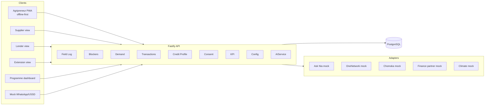
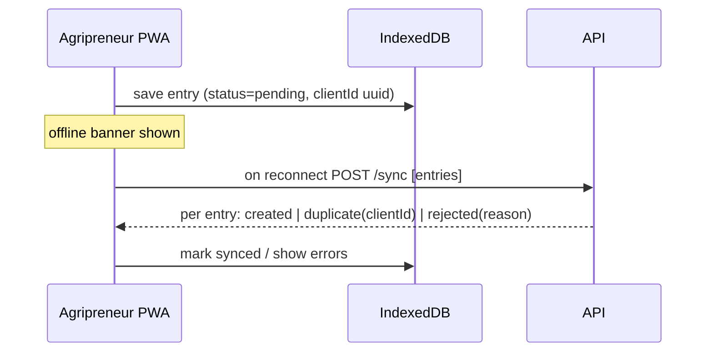

# Design: EKYAN Connect MVP

## 1. Architecture


## 2. Data model (Prisma-style summary)
```text
Organisation(id, name, type[supplier|lender|buyer|county|programme|partner], countyId)
User(id, name, phone, role, organisationId?, gender, disability?, countyId, createdAt)
County(id, name, country)               ValueChain(id, name, active)
InputItem(id, valueChainId, name, unit) BlockerCategory(id, name, defaultRoute, slaDays)
Farmer(id, agripreneurId, name, phone?, village, ward?, countyId, gender, disability?,
       consentToRecord, synthetic, createdAt)
Order(id, farmerId, agripreneurId, inputItemId, quantity, neededBy, status[open|grouped|committed|fulfilled|cancelled],
      demandGroupId?, actedBy, onBehalfOf, synthetic, createdAt)
DemandGroup(id, inputItemId, countyId, ward?, weekStart, totalQty, farmerCount, status[open|committed|fulfilled])
SupplierCommitment(id, demandGroupId, supplierOrgId, unitPriceKes, deliveryDate, status)
Blocker(id, farmerId?, agripreneurId, categoryId, description, voiceNoteUrl?, urgency[low|med|high],
        aiSuggestedCategoryId?, aiConfidence?, routeTo, assigneeId?, status, resolutionNote?, createdAt, resolvedAt?)
Transaction(id, agripreneurId, type[sale|purchase|service], amountKes, counterparty?, date, synthetic)
SavingsRecord(id, agripreneurId, month, amountKes, source='chomoka_mock')
CreditProfile(id, agripreneurId, score, band, factorsJson, computedAt, version)
Consent(id, agripreneurId, lenderOrgId, purpose, grantedAt, expiresAt, revokedAt?)
ProgrammeCost(id, periodStart, periodEnd, countyId?, amountUsd)
AuditLog(id, actorId, action, entity, entityId, onBehalfOf?, at, meta)
SyncQueue (client-side IndexedDB only)
```

## 3. Key flows

### 3.1 Offline field log

Idempotency via `clientId`. Conflicts: last-write-wins with audit.

### 3.2 Blocker triage and routing
1. Agripreneur writes description (or voice note → stub transcript).
2. `AIService.triageBlocker(text)` returns `{categoryId, urgency, confidence, rationale}` (rules + keywords; optional LLM provider via env).
3. Agripreneur confirms or edits → status `open`; routing rule from `BlockerCategory.defaultRoute`.
4. Assignee updates status; SLA job flags overdue daily.

### 3.3 Demand pooling
- Nightly + on-demand job groups `open` orders by `inputItemId × countyId × ward × ISO week(neededBy)` into `DemandGroup`.
- Supplier sees groups (aggregates only), commits price + date.
- Orders → `committed`; agripreneur confirms delivery → `fulfilled`.
- Forecast: 4-week moving average of quantity per item × county.

### 3.4 Credit-readiness score (v0, transparent rules)
| Factor | Max points | Rule |
|---|---|---|
| Record consistency | 25 | months with ≥4 entries in last 6 months × ~4.2 |
| Revenue level | 20 | scaled vs configurable reference (default KES 50,000/month) |
| Revenue trend | 15 | 3-month slope ≥ 0 → points |
| Customer base | 15 | distinct farmers served, capped |
| Fulfilment reliability | 15 | fulfilled ÷ committed orders |
| Savings activity | 10 | months with savings (mock Chomoka) |
Bands: 0–39 Early stage · 40–69 Building history · 70–100 Ready for input-finance conversation.
Weights live in config, versioned. Protected attributes are excluded by construction (scorer receives a DTO without them; unit test asserts it).

### 3.5 Consent
`POST /consents` (agripreneur) → lender reads `GET /profiles/:agripreneurId` only if active consent exists; every read audited; `DELETE /consents/:id` revokes.

## 4. API (excerpt)
```text
POST   /auth/otp/request | /auth/otp/verify          (mock)
GET    /config/*                                     catalogue, categories, counties
POST   /farmers           GET /farmers?mine=true
POST   /orders            POST /blockers            POST /transactions
POST   /sync                                         batch offline entries
POST   /blockers/:id/triage   PATCH /blockers/:id   GET /blockers?assignedToMe
GET    /demand-groups?county=&item=   POST /demand-groups/:id/commitments
POST   /orders/:id/fulfil
GET    /profiles/me       POST /consents   DELETE /consents/:id
GET    /profiles/:agripreneurId          (lender, consent-gated)
GET    /kpi?from=&to=&county=&gender=    GET /kpi/export.csv
GET    /data-quality      POST /programme-costs
POST   /advisory/ask      (AdvisoryAdapter mock)
GET    /reports/fairness
```

## 5. UI screens
- **Agripreneur:** Home (today's tasks, pending sync), Farmers, New entry (3 big buttons: Order · Blocker · Sale), My blockers, My business (income/expense chart, profile score with factors, consent manager), Ask (advisory).
- **Supplier:** Demand board (cards by item/area/week, forecast sparkline), My commitments.
- **Lender:** Consented profiles list, profile detail with factor explanations and "not a credit decision" label.
- **Extension:** Assigned blockers by urgency and ward.
- **Programme:** KPI tiles, funnel, blockers by category, county filter, data-quality panel, cost input, CSV export.
All views: language toggle, synthetic-data banner, icon + text.

## 6. Seed data
Busia County, 3 wards; 15 agripreneurs (≥ 50% women, 2 with disabilities); ~1,500 farmers; 6 months of transactions; ~2,000 orders; ~300 blockers across categories; 3 suppliers; 1 lender; 1 buyer; programme cost entries. All `synthetic = true`. Deterministic random seed.

## 7. Testing strategy
- Unit: aggregation, scoring (incl. protected-attribute exclusion), routing, SLA, consent gating, KPI formulas.
- E2E (Playwright): offline log → sync; blocker → resolve; supplier commit → fulfil; consent grant → lender view → revoke → denied.
- Fairness report test: produces group distributions without error.
